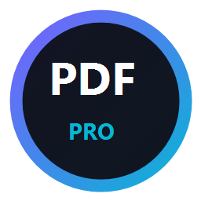
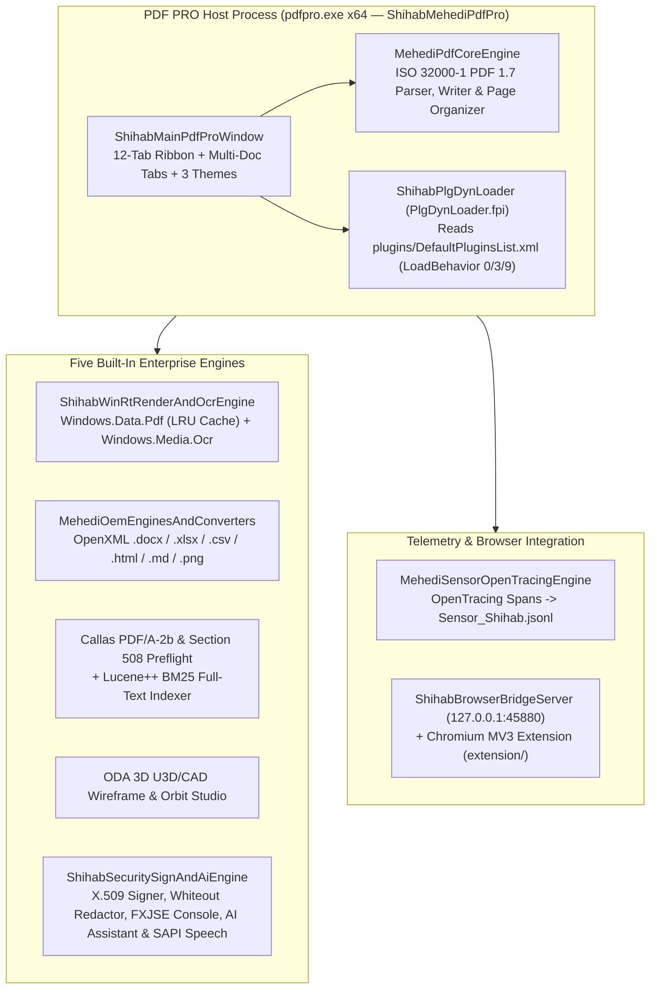

<div align="center">



# PDF PRO (`pdfpro.exe` v14.0.4 — Starship Architecture Edition)

**Enterprise Open-Source Windows x64 PDF Editor, Neural OCR, Solid Office Converter, Callas PDF/A Preflight, X.509 Signer & AI Suite**

Developed by **[Mehedi Hasan Shihab](https://sshihabb007.github.io/)** (`@sshihabb007`)

[](https://github.com/sshihabb007/PDFpro/actions/workflows/build-and-release.yml)
[](https://github.com/sshihabb007/PDFpro/releases/latest)
[-06B6D4?style=for-the-badge&logo=windows&logoColor=white)](#)
[](#architecture)
[](#build-from-source)
[](LICENSE)

</div>

---

## Download Latest Release (Portable EXE & Setup Installer)

Every push and version tag triggers the automated [GitHub Actions CI/CD Release Pipeline](.github/workflows/build-and-release.yml), which compiles, self-tests, and publishes both the **Portable EXE** and **Setup Installer EXE** on the [GitHub Releases Page](https://github.com/sshihabb007/PDFpro/releases/latest):

| Package | Direct Download | Description |
| :--- | :--- | :--- |
| **Portable EXE (No Install)** | [`PDF-PRO-Portable-14.0.4-x64.exe`](https://github.com/sshihabb007/PDFpro/releases/latest/download/PDF-PRO-Portable-14.0.4-x64.exe) | Single-file standalone Windows x64 portable executable — run directly from any folder or USB drive |
| **Setup Installer Wizard (EXE)** | [`PDF-PRO-Setup-14.0.4-x64.exe`](https://github.com/sshihabb007/PDFpro/releases/latest/download/PDF-PRO-Setup-14.0.4-x64.exe) | Full GUI Setup Wizard — installs to `%LOCALAPPDATA%\Programs\PDF PRO`, creates Desktop & Start Menu shortcuts, and supports `--silent` |
| **Portable Bundle (ZIP)** | [`PDF-PRO-Portable-14.0.4-x64.zip`](https://github.com/sshihabb007/PDFpro/releases/latest/download/PDF-PRO-Portable-14.0.4-x64.zip) | Complete portable archive containing `pdfpro.exe`, 14 `.fpi` plugin descriptors, assets, and Chromium Web2PDF extension |
| **SHA-256 Checksums** | [`SHA256SUMS.txt`](https://github.com/sshihabb007/PDFpro/releases/latest/download/SHA256SUMS.txt) | Official SHA-256 digests for all release binaries |

---

## Overview

**PDF PRO (`pdfpro.exe` v14.0.4.33508)** is a clean-room, open-source Windows x64 PDF editor and document transformation suite engineered by **Mehedi Hasan Shihab (`@sshihabb007`)**, modeled directly on the **Foxit PDF Editor Pro (`Starship` 14.0.4)** behavioral architecture:

1. **Monolithic Host + Dynamic `.fpi` Plugin Loader (`ShihabPlgDynLoader`)**: Reads [`plugins/DefaultPluginsList.xml`](plugins/DefaultPluginsList.xml) (`32` plugins across `LoadBehavior=0` Bootstrap, `LoadBehavior=3` Eager Core, and `LoadBehavior=9` On-Demand Lazy loading) and exposes the host's FXJSE JavaScript bridge, UI skin manager, and OpenTracing telemetry bus.
2. **Hardware-Accelerated Direct2D PDF Rendering + Live Content-Stream Editing (`ShihabWinRtRenderAndOcrEngine` & `MehediPdfCoreEngine`)**: Combines Windows 10/11 `Windows.Data.Pdf.PdfDocument` high-DPI rendering (with a 24-bitmap LRU cache) and a pure C# ISO 32000-1 PDF 1.7 parser/writer (`xref`, `FlateDecode`, `BT ... ET` text streams, in-place paragraph editing, annotations, shapes, stamps, watermarks, headers/footers, and Bates numbering).
3. **Five Built-in Enterprise Transformation & Inspection Engines (`MehediOemEnginesAndConverters`)**:
   - **Neural OCR Engine (`MehediOcrRecognition`)**: Uses `Windows.Media.Ocr.OcrEngine` to recognize words and bounding boxes on any page or image and inject a searchable/editable PDF text layer.
   - **Solid Office Exporter (`ShihabFxExport`)**: Exports PDFs to native OpenXML **Word (`.docx`)**, **Excel (`.xlsx` / `.csv`)**, **HTML5 (`.html`)**, **Markdown (`.md`)**, **Plain Text (`.txt`)**, and high-DPI **PNG images**, plus converts external images and documents into PDF.
   - **Callas PDF/A-2b & Section 508 Preflight (`MehediPdfaPreflight`)**: Audits ISO 19005-2 (`PDF/A-2b`) and `PDF/UA` compliance and executes automated preflight fixups.
   - **Lucene++ Full-Text Search Indexer (`MehediLuceneSearch`)**: Tokenizes document pages and annotations with BM25 relevance ranking and context snippets.
   - **ODA 3D U3D/CAD Viewport (`ShihabU3dBrowser`)**: Interactive 3D wireframe/node perspective viewport with Yaw/Pitch/Zoom orbit controls and page snapshot stamping.
4. **Enterprise Security, X.509 Signing, Redaction & Built-in AI (`ShihabSecuritySignAndAiEngine`)**:
   - **Permanent Whiteout Redaction (`ShihabWhiteoutRedaction`)** & **Automated PII Scanner** (emails, phone numbers, SSNs).
   - **X.509 / PKCS#7 Digital Signatures (`MehediDocSign`)** & **Microsoft MIP/AIP Sensitivity Labels (`ShihabAipLabel`)**.
   - **FXJSE V8-Compatible JavaScript Automation Console (`ShihabJsDebugger`)**.
   - **Shihab AI Document Assistant (`ShihabAiAssistant`)** for Executive Summaries, natural-language Document Q&A, and entity extraction.
   - **Windows SAPI Read Out Loud (`MehediSpeechReadOutLoud`)** text-to-speech synthesis.
   - **OpenTracing Telemetry Ledger (`MehediSensorOpenTracingEngine`)** recording structured spans to `Sensor_Shihab.jsonl`.

---

## System Architecture



---

## Build & Verification (`build.ps1`)

Run `./build.ps1` from PowerShell to generate brand icons, compile `bin\pdfpro.exe` and `bin\PDF-PRO-Setup-14.0.4-x64.exe` using the inbox Windows `.NET Framework 4.8` x64 compiler (`csc.exe`) + Windows 10/11 WinRT metadata, and execute the automated self-test suite (`--self-test`):

```powershell
powershell -ExecutionPolicy Bypass -File .\build.ps1
```

### CLI Automation Reference

```powershell
# Launch the full PDF PRO 14.0.4 GUI Workstation
.\bin\pdfpro.exe

# Open a specific PDF file in the GUI
.\bin\pdfpro.exe .\bin\samples\PDF-PRO-Starship-Showcase-Shihab.pdf

# Run the automated end-to-end self-verification suite (PDF 1.7 write/read, WinRT OCR, DOCX/XLSX/CSV/HTML export, Lucene search, plugins, telemetry)
.\bin\pdfpro.exe --self-test .\bin\samples

# Export a PDF directly to Microsoft Word (.docx) or Excel (.xlsx)
.\bin\pdfpro.exe --export-docx input.pdf output.docx
.\bin\pdfpro.exe --export-xlsx input.pdf output.xlsx
```

---

## Developer

- **Author**: **Mehedi Hasan Shihab** (`@sshihabb007`)
- **Repository**: [https://github.com/sshihabb007/PDFpro](https://github.com/sshihabb007/PDFpro)
- **Website**: [https://sshihabb007.github.io/](https://sshihabb007.github.io/)
- **GitHub**: [https://github.com/sshihabb007](https://github.com/sshihabb007)

